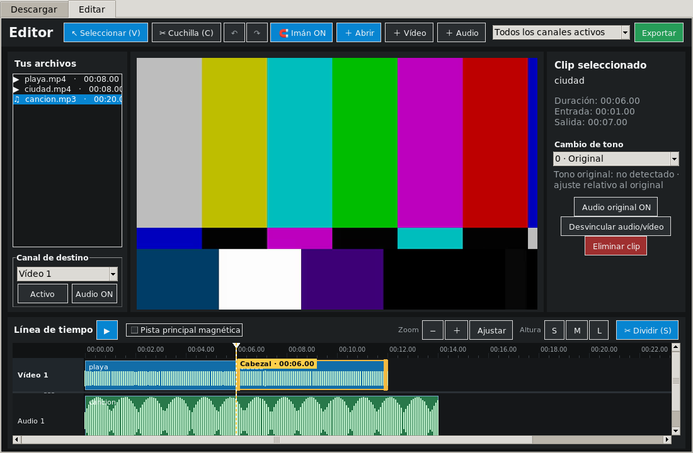

# AveDescargas

**Descargador de medios y editor multipista para Windows**, construido con Python y Tkinter.

> Proyecto personal en desarrollo. La interfaz y algunas funciones pueden cambiar entre versiones. Consulta **[Releases](https://github.com/Avesthyle/AveDescargas/releases)** para obtener las versiones publicadas (`AveDescargasEditor-portable.zip` incluye FFmpeg: descomprimir y abrir `AveDescargasEditor.exe`).

## Funciones

- Descarga de vídeo y audio con selección de calidad, fragmentos y carpeta.
- Aviso e importación selectiva para enlaces que apuntan a listas de reproducción.
- Editor multipista con imán (los clips se pegan solos a otros clips y al cabezal), recorte de bordes, altura de pistas ajustable, cierre de huecos, pista principal magnética y deshacer/rehacer.
- Recorte no destructivo, forma de onda, vista previa y exportación multipista con FFmpeg.
- Reproducción desde el cabezal de edición y atajos de teclado.
- Guía completa y atajos del editor: **[docs/EDITOR.md](docs/EDITOR.md)**.



La disponibilidad de formatos de descarga depende del sitio y de sus condiciones. Utiliza la aplicación únicamente con contenido que tengas derecho a descargar.

## Requisitos

- Windows 10/11 de 64 bits.
- Python 3.12 o posterior para ejecutar desde el código.
- FFmpeg, FFprobe y FFplay accesibles en el PATH, en `C:\ffmpeg\bin` o en una carpeta `ffmpeg\bin` junto al ejecutable.
- Conexión a Internet para las funciones de descarga.

## Puesta en marcha desde código

```powershell
git clone https://github.com/Avesthyle/AveDescargas.git
cd AveDescargas
py -3 -m venv .venv
.venv\Scripts\Activate.ps1
py -m pip install --upgrade pip
py -m pip install -r requirements.txt
py -3 media_grabber_editor.py
```

## Pruebas

```powershell
py -3 -m unittest test_magnetic_timeline test_media_editor test_media_grabber test_editor_panel_gui
```

## Compilar el editor

Instala PyInstaller con `py -m pip install pyinstaller` y ejecuta:

```powershell
py -m PyInstaller --noconfirm AveDescargasEditor.spec
```

El resultado se genera en `dist/AveDescargasEditor.exe` (GitHub Actions también lo compila automáticamente en cada push; ver [`.github/workflows/build-windows.yml`](.github/workflows/build-windows.yml)).

## ¿Es portable el EXE?

El `.exe` suelto es un ejecutable de archivo único de PyInstaller y no requiere instalar Python por separado, aunque necesita FFmpeg en el equipo (por eso se publica también `AveDescargasEditor-portable.zip` con FFmpeg incluido). En el primer inicio, PyInstaller puede extraer componentes temporales en la carpeta temporal de Windows.

## Estructura

| Archivo | Propósito |
|---|---|
| `media_grabber.py` | Interfaz y lógica principal de descargas |
| `media_editor.py` | Modelos de clips, línea de tiempo, FFmpeg y exportación |
| `simple_editor_panel.py` | Editor visual multipista |
| `media_grabber_editor.py` | Punto de entrada de la aplicación |
| `editor_panel.py` | Panel de edición alternativo |
| `AveDescargasEditor.spec` | Configuración de PyInstaller |
| `AGENTS.md` / `TAREAS.md` | Guía técnica del proyecto y registro de rondas |
| `test_*.py` | Pruebas automatizadas |

## Informar de un problema

Abre un [issue](https://github.com/Avesthyle/AveDescargas/issues) e indica Windows, versión de AveDescargas, pasos para reproducir y el mensaje de error. No adjuntes cookies, tokens, contraseñas ni archivos multimedia privados.

## Licencia

No se ha añadido una licencia todavía. Hasta que el autor elija una, no asumas que el código puede redistribuirse o reutilizarse.
