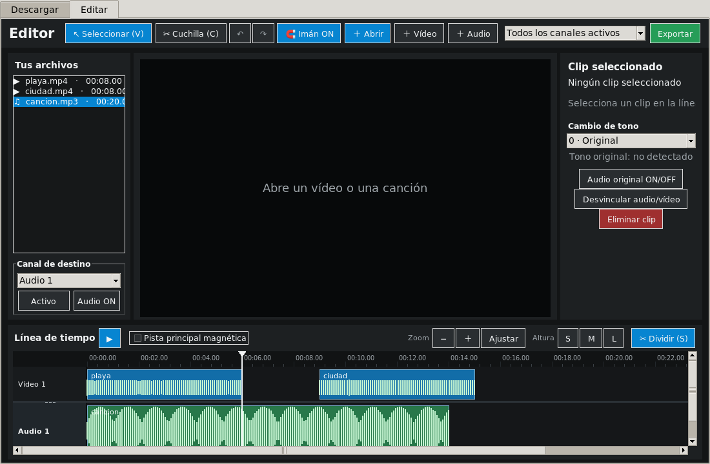
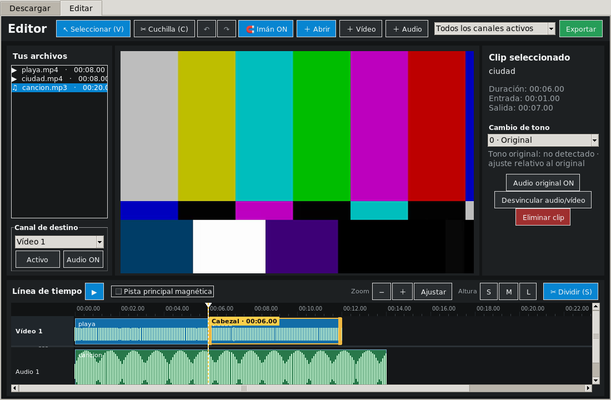
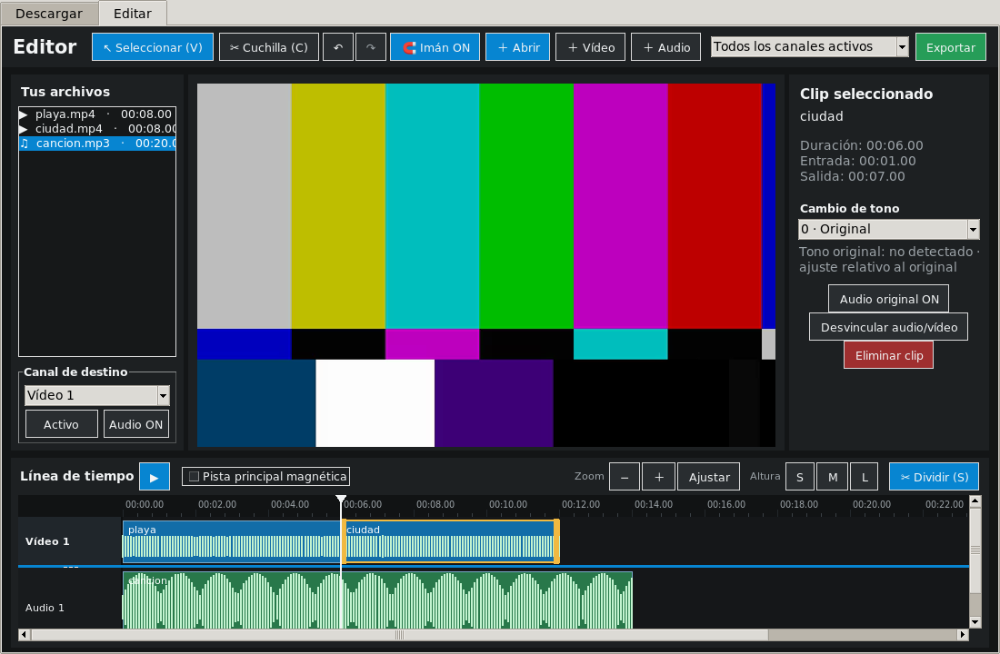

# Editor de vídeo de AveDescargas

Guía del editor multipista: cómo se usa la línea de tiempo magnética, los atajos y cómo está construido por dentro.



## Línea de tiempo magnética

### Imán al mover clips
Al arrastrar un clip, **sus dos bordes** se enganchan automáticamente a:

| Punto magnético | Ejemplo |
|---|---|
| Final o inicio de cualquier clip (de **cualquier pista**) | pegar un vídeo justo detrás del anterior |
| El **cabezal** de reproducción | alinear un clip con el momento exacto que estás viendo |
| El **inicio** del proyecto (00:00) | colocar el primer clip |

El radio de enganche es de **12 píxeles en pantalla**, así que funciona igual con cualquier zoom.
Mientras engancha aparece una **línea guía amarilla** con una etiqueta que dice a qué se ha pegado (`Cabezal · 00:06.00`, `Clip · 00:04.00`…).



- **Alt** mientras arrastras → desactiva el imán temporalmente (movimiento libre).
- **🧲 Imán ON/OFF** en la barra superior → lo desactiva del todo.
- Un clip nunca se solapa con otro de la misma pista: si lo sueltas encima, se coloca pegado al vecino.
- Si el clip tiene el audio vinculado (🔗), el audio se mueve con él.

### Imán al recortar
Arrastra el **borde izquierdo o derecho** de un clip (el cursor cambia a `↔`). El borde se engancha al cabezal y a los bordes de otros clips, y la etiqueta muestra también la duración resultante.

### Imán con la cuchilla
Con la cuchilla (**C**) o con **S**, el corte se ajusta al cabezal o al borde de un clip de otra pista si estás a menos de 12 px.

### Cerrar huecos
- **Clic derecho en un hueco → «Cerrar hueco»**: todos los clips posteriores de esa pista se desplazan a la izquierda.
- **Shift+Supr** (o clic derecho → «Eliminar y cerrar hueco»): borra el clip y junta los siguientes.

### Pista principal magnética
Activa la casilla **«Pista principal magnética»** encima de la línea de tiempo. La primera pista de vídeo pasa a comportarse como en CapCut / Final Cut:
- los clips siempre quedan **uno detrás de otro desde 00:00, sin huecos**;
- arrastrar un clip detrás de otro **los reordena**;
- borrar un clip junta el resto automáticamente.

## Altura de las pistas



- Pasa el ratón por la **línea entre dos pistas**: se ilumina en azul y el cursor cambia a `↕`. Arrástrala para cambiar la altura.
- **Ctrl + rueda** encima de una pista → más alta / más baja.
- Botones **Altura S / M / L** → todas las pistas a la vez.
- **Clic derecho** en una pista → altura pequeña / mediana / grande solo para esa pista.

## Zoom y desplazamiento

| Acción | Cómo |
|---|---|
| Acercar / alejar | botones **− / ＋**, o **Alt + rueda** (centrado en el ratón) |
| Ver todo el montaje | botón **Ajustar** |
| Desplazar horizontalmente | **Shift + rueda** o barra inferior |
| Desplazar verticalmente | **rueda** |

La regla de tiempo cambia sus marcas automáticamente según el zoom.

## Atajos de teclado

Los atajos solo funcionan cuando la pestaña **Editar** está visible y **no** estás escribiendo en un campo de texto (por ejemplo, la URL en la pestaña Descargar).

| Tecla | Acción |
|---|---|
| **V** | Herramienta Seleccionar |
| **C** | Herramienta Cuchilla |
| Clic central (mantener) | Cuchilla temporal |
| **S** o **Ctrl+K** | Dividir en el cabezal |
| **Supr** / **Retroceso** | Eliminar clip (y su audio vinculado) |
| **Shift+Supr** | Eliminar y cerrar hueco |
| **Ctrl+Z** | Deshacer |
| **Ctrl+Y** o **Ctrl+Shift+Z** | Rehacer |
| **Espacio** | Reproducir / pausar |
| **Inicio** / **Fin** | Cabezal al principio / al final |
| **Alt** (arrastrando) | Mover o recortar sin imán |

## Deshacer / rehacer
Todas las operaciones de edición (mover, recortar, dividir, borrar, cerrar huecos, añadir o borrar pistas, alturas) se pueden deshacer, hasta 60 pasos. Un clic sin cambios no ocupa un paso del historial.

---

## Arquitectura (para desarrolladores)

| Archivo | Contenido |
|---|---|
| `media_editor.py` | Modelo (`Clip`, `Track`, `EditorProject`), exportación con FFmpeg y **funciones puras** de la línea de tiempo: `snap_point`, `snap_timeline_position`, `collect_snap_points`, `find_gap`, `close_gap`, `ripple_delete`, `compact_clips`, `track_layout`, `track_boundary_at`… |
| `simple_editor_panel.py` | Interfaz Tkinter del editor. Toda la geometría de pistas pasa por `_layout()` → `track_layout()`, de modo que dibujo, clics y redimensionado usan exactamente las mismas posiciones. |
| `media_grabber_editor.py` | Punto de entrada del ejecutable. |

Decisiones importantes:
- **Una sola fuente de verdad para la geometría.** Antes cada función calculaba la posición de las pistas a su manera (`row * row_height`), y al cambiar la altura de una pista las zonas de clic y el dibujo dejaban de coincidir.
- **El radio del imán se define en píxeles** (`SNAP_PIXELS`) y se convierte a segundos con `snap_threshold(zoom)`.
- **Seleccionar un clip ya no mueve el cabezal**, como en Premiere/DaVinci; así el cabezal sirve como punto magnético.
- **Las formas de onda se calculan en segundo plano** y llegan a la interfaz por `ui_queue`; antes congelaban la ventana al añadir un clip.
- **Deshacer** guarda instantáneas (`copy.deepcopy`) de pistas, selección y alturas.

### Tests

```bash
# Lógica (cualquier sistema)
python -m unittest test_magnetic_timeline test_media_editor test_media_grabber

# Interfaz con Tk real, ratón y teclado simulados (en Linux sin pantalla, con Xvfb)
xvfb-run -a python -m unittest test_editor_panel_gui
```

`test_editor_panel_gui.py` arrastra clips, bordes y separadores con eventos reales de Tk y comprueba el resultado, e incluye una prueba de extremo a extremo que genera vídeos con FFmpeg, los suelta en la línea de tiempo, comprueba el imán y exporta el montaje.

### Compilar el ejecutable
La compilación la hace GitHub Actions en Windows (`.github/workflows/build-windows.yml`) en cada push:
1. instala dependencias y ejecuta todos los tests;
2. compila `AveDescargasEditor.exe` con PyInstaller;
3. arranca el `.exe` 15 s para comprobar que no se cierra solo;
4. genera `AveDescargasEditor-portable.zip` con FFmpeg incluido;
5. al crear una etiqueta `v*` publica ambos archivos en *Releases*.

En local (Windows): `pip install -r requirements.txt pyinstaller` y `pyinstaller AveDescargasEditor.spec`. Los iconos se regeneran con `python tools/make_icons.py`.
